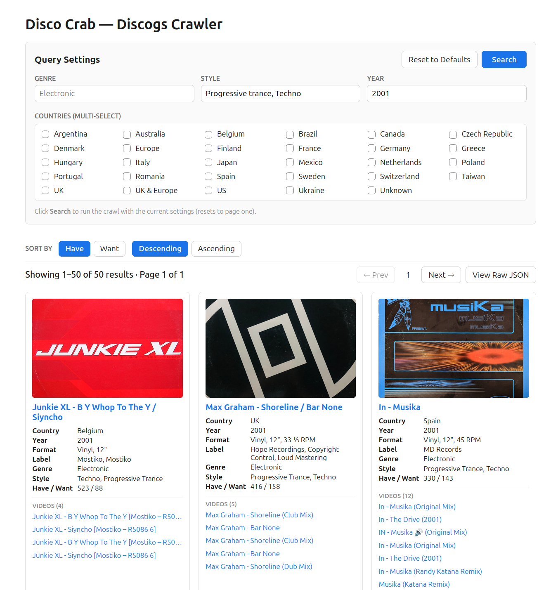

# DISCO-CRAB

Disco-crab is a simple Discogs API crawler for finding certain records from
Discogs more easily.

It makes browsing Discogs a tad quicker for example by exposing YouTube links directly
on the results page. This approach makes finding that one record you've been looking for
quicker - obviously only on cases where that release has YouTube links attached.

Results page is composed using plain *HTML / CSS / vanilla JS* with no help of external libraries.
This makes maintaining and running the project way easier on the cost of development
exprience. Backend is also only using the bare minimum amount of packages to keep the project tidy.

When hitting the search button: crawler makes first request with filters set and then requests
release information for 50 individual releases returned with the search API request.
This keeps request limit under Discog API's **60 requests / per minute** throttling
for one results page view.



## Structure

- `src/crawler.ts` — crawler queries the Discogs API on demand (`runCrawl(query)`),
  using the query settings provided via the API. After each search, it issues a
  **release sub-query** (`GET /releases/{id}`) for every result to enrich it
  with the detailed release record (tracklist, artists, formats, notes, images,
  …). All requests pass through a token-bucket rate limiter.
- `src/api.ts` — HTTP server. Each `/api?page=N` request triggers a
  `runCrawl(query)`, then serves the cached results (50 per page). Any
  non-`/api` request serves the static frontend from `public/` (with basic
  path-traversal protection).
- `src/config.ts` — loads configuration from an `.env` file (`--config <path>`).
- `public/` — the static frontend: `index.html`, `styles.css`, `app.js`.
  It talks directly to the crawler API at the same origin (`/api`).
- `.env` - config for accessing the Discogs API (**this needs to be made by user**)

## Installing / building / running

Make `.env` file to project root and add your Discogs API token in it with following syntax:
```
ACCESS_TOKEN=ACCESS_TOKEN_HERE
```

Install depedencies first:

```
npm install
```

Then start using by running by first compiling and running built version:

```
npm run build
npm start
```

or by running in dev-mode:
```
npm run dev
```

Crawler is available at: **http://localhost:3333**

The API is also reachable directly: `http://localhost:3333/api?page=1`. Refer to code
for more detailed information about direct requests to API.

## Rate limiting & release sub-query

The Discogs API hard-limits authenticated requests to 60 per minute. Every
search page of 50 results triggers 50 additional release sub-queries, so a
single crawl step issues up to **51 requests**. To stay under the cap:

- Search results are limited to **50 per page** (`CRAWL_QUERY_LIMIT`).
- A built-in **token-bucket rate limiter** throttles every request (search +
  release sub-queries) so the crawler never exceeds the configured limit.

The limit is read from the `REQUESTS_PER_MINUTE` key in `.env` (if set - otherwise defaults to `60`):

```
ACCESS_TOKEN=...
REQUESTS_PER_MINUTE=60
```

Fetched release records are cached by release id, so revisiting the same page
reuses cached details instead of refetching from Discogs.